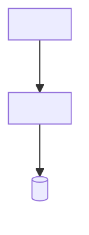
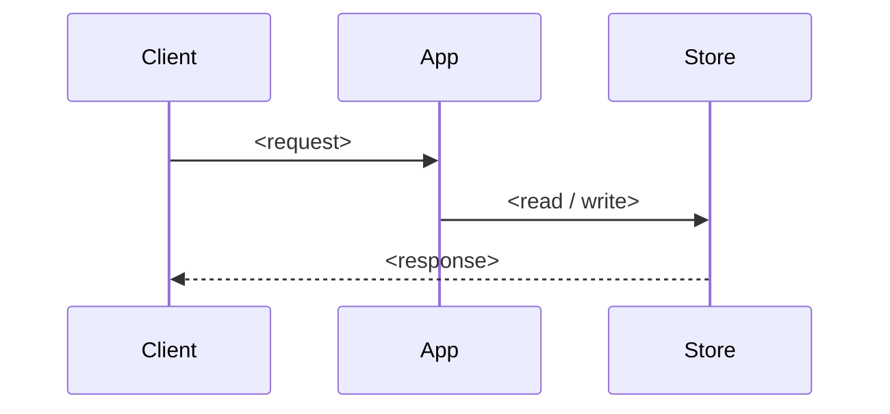

<!-- TEMPLATE NOTICE
本檔案是 claude-code-setup-v1 template 的一部分。
採用到新專案時,請替換所有 `<Placeholder>` 佔位符與 `<!-- TEMPLATE: ... -->` 註解區塊。
由 maintaining-architecture-md skill 的 Workflow A 在專案架構成形時首次填寫。
完整使用說明見 template 根目錄的 `README.md`。
-->

# Architecture — `<Project Name>`

<!-- TEMPLATE: Replace with a one-paragraph plain-language summary of what the system is and how its parts fit together. -->
`<One paragraph: 系統做什麼、由哪些部分組成、如何協作>`

本文是可讀的設計藍圖(onboarding 用):串起系統現行全貌、技術選型與資料流。**需求(What must do)見 [SPEC.md](../SPEC.md);決策理由(Why)見 [journal.md](journal/journal.md) 的對應 ADR。** 本文描述「現在長什麼樣」,不重述需求、不展開決策推理,只串全局並連結。

---

## System Overview

<!-- TEMPLATE: Replace with your actual system diagram. Mermaid is preferred (version-controllable, renders on GitHub / Claude Code). -->



---

## Components

每層/模組一句話 + 對應 ADR(若該設計有決策脈絡)。

<!-- TEMPLATE: Replace rows with your actual modules. ADR 欄連到 journal 對應決策;尚無 ADR 留 — -->

| 層 / 模組 | 摘要 | 相關 ADR |
|----------|------|---------|
| `<module-a>` | `<一句話職責>` | [ADR-XXXX](journal/journal.md#adr-xxxx-...) |
| `<module-b>` | `<一句話職責>` | — |

---

## Tech Stack

<!-- TEMPLATE: 此表自 CLAUDE.md 移入,是「現行技術選型」的 SoT。新增依賴 / 換框架時更新此處(由 maintaining-architecture-md 維護),不再寫在 CLAUDE.md。 -->

| 層 | 選型 |
|----|------|
| Language | `<e.g., Python 3.11+>` |
| Package Manager | `<e.g., uv>` |
| Framework | `<your framework>` |
| Testing | `<e.g., pytest, pytest-asyncio>` |
| Linter / Formatter | `<e.g., ruff>` |
| Type Checker | `<e.g., mypy>` |
| 其他依賴 | `<DB client / SDK / message queue 等>` |

---

## Code Structure

<!-- TEMPLATE: Replace with your actual source tree. 這是「現行目錄結構」,自 CLAUDE.md 移入。 -->

```
<project-name>/
├── src/
│   └── <your-modules>/
├── tests/
│   ├── unit/
│   ├── integration/
│   └── e2e/
└── ...
```

---

## Data Flow

<!-- TEMPLATE（選配）：有值得說明的核心流程才畫;CRUD 型小專案可刪除本節。 -->



---

## Design Decisions

現行架構背後的關鍵決策索引。每條僅摘要,完整 Context / Alternatives 見對應 ADR。

<!-- TEMPLATE: 每個影響架構走向的決策在 journal 開 ADR 後,於此加一列摘要 + cross-ref。 -->

| 決策 | 摘要 | ADR |
|------|------|-----|
| `<決策標題>` | `<1 行現行做法>` | [ADR-XXXX](journal/journal.md#adr-xxxx-...) |

---

## Related Documents

- [SPEC.md](../SPEC.md) — 需求與驗收(What must do)
- [journal.md](journal/journal.md) — 決策史(Why)+ Lessons + Timeline
- [CLAUDE.md](../CLAUDE.md) — 開發規範與原則(constitution)

---

**Last Updated**: `<YYYY-MM-DD>`
**Version**: `<vX.Y.Z>`
